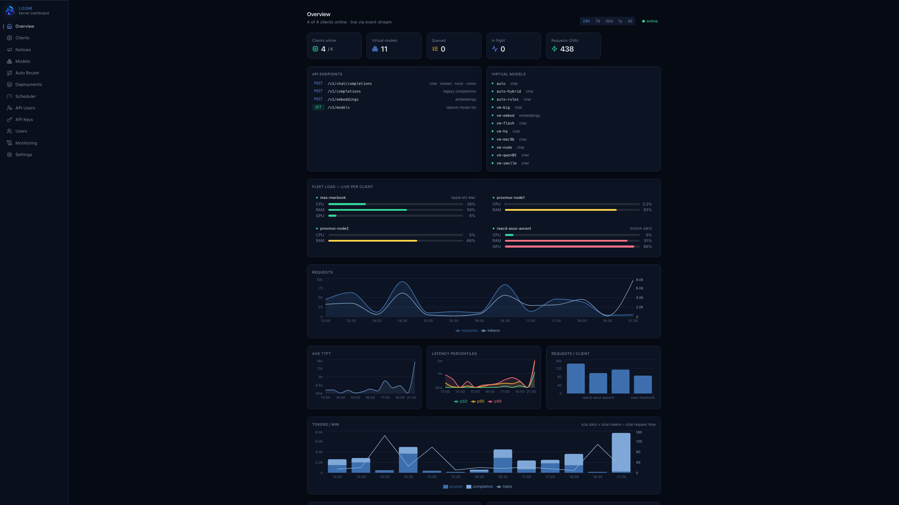
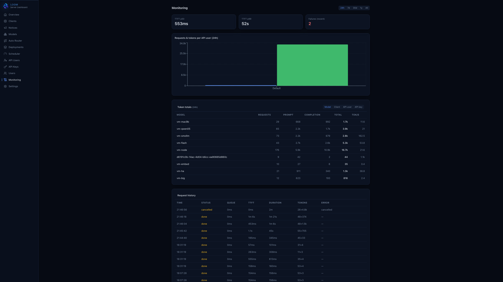
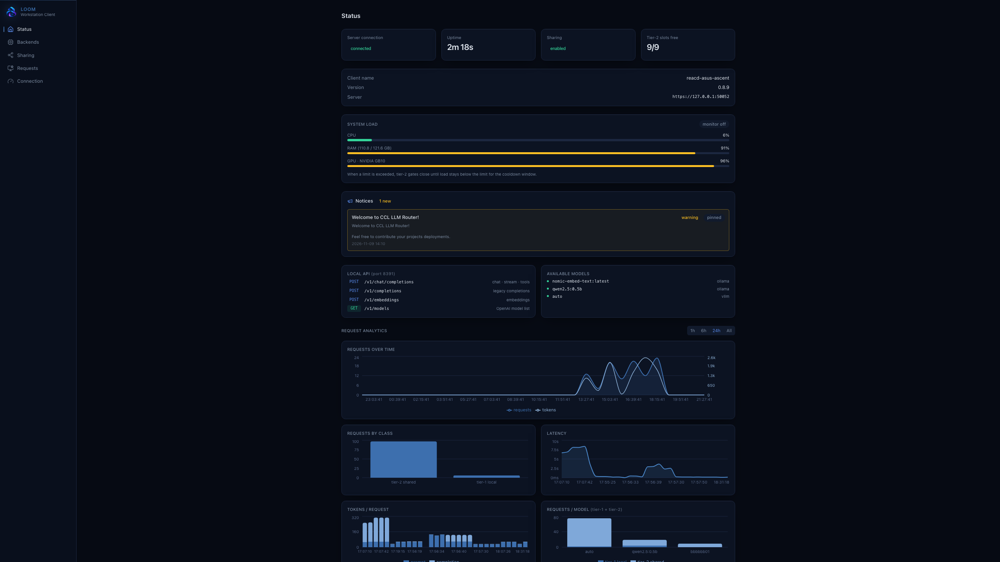
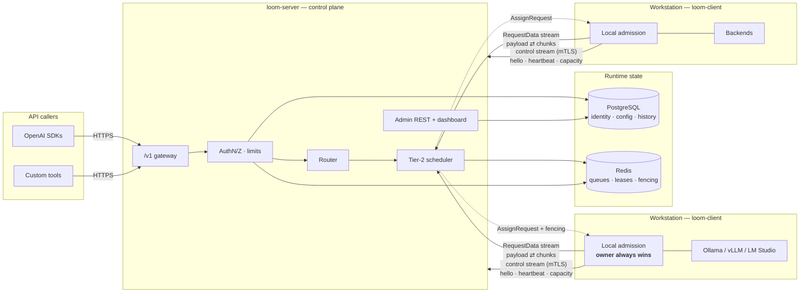
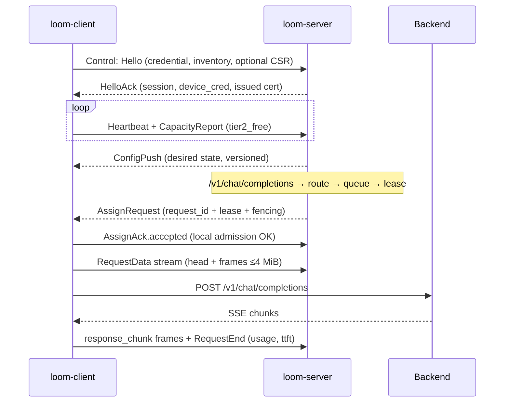
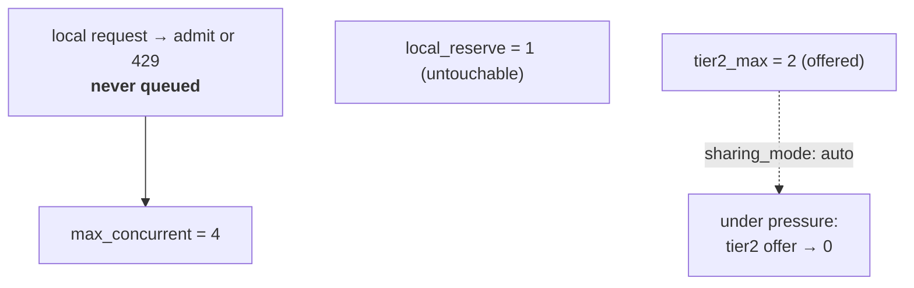

<div align="center">


# LOOM

### LLM Orchestration & Operations Mesh

**Turn idle workstation GPUs into a shared, centrally-managed inference mesh —**
**with hard guarantees that local workloads always come first.**

[](https://github.com/maxk2222/loom/actions/workflows/ci.yml)
[](https://github.com/maxk2222/loom/releases)
[](https://github.com/maxk2222/loom/releases/latest)
[](LICENSE)

[](https://www.rust-lang.org)
[](https://www.postgresql.org)
[](https://redis.io)
[](docs/protocol.md)
[](deploy/)
[](docs/protocol.md)

</div>

---

## What is LOOM

Research labs are full of powerful workstations that sit idle most of the
time. LOOM pools that scattered capacity behind **one OpenAI-compatible
endpoint** — without taking anything away from the people using the machines.

```text
POST /v1/chat/completions  →  loom-server (route · queue · auth · meter)
                           →  whichever workstation has a free tier-2 slot
                              (collapses to zero the moment its owner needs it)
```

| | |
|---|---|
| 🏠 **Local-first** | Workstation workloads always win — shared capacity is opportunistic spare, never guaranteed |
| 🔀 **Smart routing** | Virtual models, 5 strategies, capability filters, heuristic/hybrid/LLM routers, routing traces |
| 🛡️ **Fence-protected** | Fencing tokens + atomic Redis Lua leases — no split-brain double-execution |
| 📊 **Observable** | Dark dashboard, live SSE, TTFT p50/p99, per-user usage, audit trail |
| 🔌 **Real OpenAI API** | Chat · completions · embeddings · streaming · tools · vision · media (images/audio/video) |
| 🧩 **Any backend** | Ollama, vLLM, llama.cpp, LM Studio, generic OpenAI-compatible; Azure/Anthropic/OpenRouter as remote backends |
| 🔐 **mTLS by default** | Automatic PKI: certs issued and renewed with zero tooling |

## Screenshots

<div align="center">

<br/><sub>Admin dashboard — fleet load, time-windowed charts, token breakdowns, virtual models</sub>
<br/><br/>

<br/><sub>Workstation client — system load, tier-2 sharing, request analytics</sub>
<br/><br/>



<br/>
<sub>Overview · Monitoring with per-model/client/key totals · Client status — dark-only, one codebase, two build variants</sub>
</div>

Regenerate with `docs/scripts/capture-ui.mjs` (1440p captures, scripted GIF walkthroughs).

## Architecture



**Design invariants**

- The server **never talks to inference backends** — all payload traffic
  rides client-initiated gRPC streams (no inbound ports on workstations;
  the only client listener is the loopback UI on `127.0.0.1:8391`)
- **Local-first is not a setting**: the client's admission control has the
  final word on every request; the tier-2 offer shrinks to zero under
  local CPU/RAM pressure automatically
- **Prompts and responses are never persisted** — not in Postgres, Redis,
  logs or metrics; metadata only

<details>
<summary><b>Channel split detail</b></summary>



</details>

## Quickstart

### Server (Docker Compose)

```bash
git clone https://github.com/maxk2222/loom.git && cd loom
cd deploy && cp .env.example .env      # set POSTGRES_PASSWORD, LOOM_DOMAIN
docker compose --profile full up -d
```

Open `https://localhost/` → the setup wizard creates the first admin.

> [!TIP]
> Split ports are deliberate: dashboard/API live on the HTTP port (`8080`,
> behind your TLS proxy), clients dial the gRPC ports — only those need to
> be reachable from workstations.

### Workstation (one command)

Dashboard → **Clients → Issue enroll token**, then:

```bash
curl -fsSL https://loom.example.com/install-client.sh | \
  sudo bash -s -- --server https://loom.example.com --token enroll_…
```

The client registers, reports its backends and appears online within
seconds — with an auto-issued mTLS certificate (see *Security*).

A container variant exists too (`deploy/docker-compose.client.yml`): the
client only proxies to wherever Ollama/vLLM actually runs.

### First request

```bash
curl -N https://loom.example.com/v1/chat/completions \
  -H "Authorization: Bearer sk-your-api-key" \
  -d '{"model": "vm-llama", "stream": true,
       "messages": [{"role": "user", "content": "Summarize the Higgs mechanism."}]}'
```

<details>
<summary><b>Build from source</b></summary>

```bash
docker compose -f deploy/docker-compose.yml up -d postgres redis
cargo run -p loom-server     # gateway :8080, grpc :50051+
cd frontend && npm run dev   # dashboard dev server :5173
cargo run -p loom-client     # local api + ui :8391
```

</details>

## Features

### Virtual models & routing

Operators define **virtual models** (`vm-llama`) mapping to deployments
across the fleet. Members are filtered by api type (chat / completions /
embeddings), required capabilities (tools, vision, streaming, json_mode,
media flags) and liveness (client online, deployment enabled,
`tier2_free > 0`), then ranked by `priority`, `least_in_flight`,
`weighted`, `round_robin` or `manual`. Every request persists a **routing
trace**.

**Auto routers** (`kind='router'`) pick the best member per request:

| Mode | How | Latency |
|---|---|---|
| `heuristic` | Deterministic `when`-rules over request metrics — `chars`, `est_tokens`, `msgs`, `code`, `images`, `audio`, `system`, `tools`, `json_mode`, `reasoning`, `nonascii`, `effort`, with `any`/`not` combinators | ~0 ms |
| `hybrid` | Rule pre-pass for obvious cases, LLM classifier only for the ambiguous rest | rules ~0 ms, else classifier cost |
| `llm` | A small engine model classifies into member names/descriptions | engine-dependent |

Members can be other virtual models (`vm:…`) or deployments (`dep:…`), and
carry `set` overrides merged into the request — e.g.
`{"ref":"vm:qwq","set":{"reasoning_effort":"high"}}` for escalation
ladders (`effort_gte`, `reasoning` intent, `tools`). Routed responses
carry `x-loom-routed-model` / `x-loom-route-reason`; failed classifications
fall back to a configured member. A dashboard test console dry-runs
classification on any prompt.

**Readiness-aware**: clients probe backends every ~10 s — health,
installed models, the actually-*loaded* set. A deployment whose model was
evicted stops `accepting` immediately and `auto_load` deployments re-warm
in the background (backoff on repeated evictions).

**Media endpoints**: `/v1/images/generations`, `/v1/audio/speech`,
`/v1/audio/transcriptions`, `/v1/audio/translations`, `/v1/videos` — gated
by explicit per-deployment capability flags, same grants/scopes/limits as
chat.

### Fairness under contention

- Strict priority classes per API user, FIFO inside each class, weighted
  DRR between users
- Global queue cap → clean `429 overloaded` (+ `Retry-After`) instead of
  collapse
- *Busy* members wait out the request deadline; *unreachable* members
  (offline) fail fast — `draining` counts as busy since pressure-gated
  members typically return
- At most 2 candidate retries before stream start; none after (a replayed
  stream would duplicate already-delivered tokens)

### Security

**Agent channel (client ↔ server) — mTLS with automatic PKI:**

```bash
# Server: strict agent port + issuance port
LOOM_GRPC_BIND=0.0.0.0:50052 \
LOOM_GRPC_TLS_CERT=/etc/loom/server.crt \
LOOM_GRPC_TLS_KEY=/etc/loom/server.key \
LOOM_MTLS=1 \
LOOM_GRPC_BOOTSTRAP_BIND=0.0.0.0:50053 \
loom-server
```

The server keeps an internal CA at `data/tls/ca.{crt,key}` (auto-created,
or reuse an existing CA dir via `LOOM_DATA_DIR`). Clients handle the rest:

- **Issuance** — the client generates a keypair, sends a CSR inside
  `Hello` over the bootstrap listener (TLS server-auth, no client cert
  needed), receives a ~180-day cert bound to its authenticated device id,
  then connects to the strict port. Setup needs only the CA file +
  enroll token.
- **Renewal** — under 30 days left, a fresh CSR rides the regular `Hello`
  (old cert still handshakes); expired → re-bootstrap.
- **Recovery** — a stored cert that no longer chains to the live CA is
  dropped after repeated TLS failures and re-issued automatically.
- Manual `client_cert_path`/`client_key_path` remain supported;
  `connector.bootstrap_url` overrides the issuance endpoint (default:
  server port + 1). `LOOM_GRPC_PLAIN_BIND` opens a plaintext h2c agent
  listener — for migrations, or as the tunnel-facing origin for a
  public Cloudflare fallback path (see `docs/runbooks/cloudflare.md`);
  keep it on the compose/loopback network, never map it to a host port.

**Multi-endpoint failover** — a client can carry an ordered endpoint
list and roams between networks automatically:

```toml
[connector]
endpoints = [
  { url = "https://loom.lan:50052", pki = true },          # LAN
  { url = "https://loom.ts.net:50052", pki = true },       # Tailscale
  { url = "https://grpc.loom.example.com", pki = false },  # public fallback
]
```

Earlier entries win. On failure the client walks the list with backoff;
on a fallback it re-probes the preferred endpoints every ~45 s and
migrates back when LAN/Tailscale returns. `pki = false` disables cert
bootstrap/CSR on that endpoint (Cloudflare terminates TLS — the device
credential still gates session identity). `server_url` keeps working as
the implicit single pki endpoint.

**Endpoint hints** — the admin can push the same list to every client
instead of editing config files (Settings → Endpoint hints, or
`PUT /api/settings/endpoint_hints` with
`[{ "url": "…", "pki": true, "scope": "lan" | "wan" | "public" }]`).
Hints ride in HelloAck: a client enrolled via only the public endpoint
automatically learns the LAN/Tailscale ones and upgrades on the next
reconnect — non-public hints lead the merged list, configured endpoints
keep their order and `pki` flags, public hints trail. TLS/CA pinning
still applies, so a hinted endpoint cannot redirect a client to a rogue
server.

**Client self-advertisement** — each Hello carries the client's local
admin UI URL (wildcard binds resolve to the detected interface IP) plus
the interface IPv4s used toward the configured endpoints. The Clients
table shows a direct "UI ↗" link and a `via mtls|plain|bootstrap` badge
revealing which listener the session uses (e.g. `plain` for the
Cloudflare tunnel path).

TLS policy on the client: `[connector] tls = "require"` upgrades any
`http://` URL, `"off"` forces plaintext, `"auto"` follows the scheme;
`ca_cert_path` pins the CA (or system roots when empty — the client also
pins the CA received at issuance).

**HTTP surface:** CSP, `X-Content-Type-Options`, `X-Frame-Options`,
`Referrer-Policy` and HSTS on every response; per-IP token bucket +
per-account lockout on login; Argon2 password hashing; HttpOnly +
`Secure` session cookies (`LOOM_SECURE_COOKIES` or behind HTTPS).

**Credentials:** enrollment tokens are one-time/short-lived; device
credentials are revocable (Clients → Suspend); `sk-…` API keys are
SHA-256 hashed, scoped per endpoint family, with RPM/TPM/concurrency
ceilings and per-user model grants — managed under **API Users**.

> [!WARNING]
> A leaked device credential or client cert enrolls *workloads*, not
> people — but a cert without its private key does nothing, and both are
> revocable in the dashboard.

### Auto-updates

Tagged releases build signed binaries for Linux/macOS/Windows
(`x86-64`/`arm64`, minisign/ed25519). Clients poll the server's release
manifest and self-update: sha256 + signature verify → staged `--version`
smoke test → atomic swap with `.prev` backup → exit; the service manager
restarts it. A boot watchdog rolls back to `.prev` if the new binary
fails to register within 3 boots. Server self-updates the same way via
`POST /api/server/update`.

> [!CAUTION]
> Always swap binaries **through the updater** — manual replacement
> bypasses the pending-boot marker and disables the crash-loop rollback.

### Dashboard

Dark-only, zero build config at deploy time: live client status, queue
depths, virtual-model editor, API user/key admin, usage charts, request
history with routing traces, audit log, runtime branding. The workstation
client embeds a minimal variant of the same React codebase.

## How sharing works



- `auto` — offer shrinks toward zero as local load rises · `fixed` —
  constant offer · `manual`/`private` — explicit control
- The central lease is a *reservation request*, not a grant — the client
  may reject any assignment and the server tries the next candidate
- Pressure offload unloads warmed models under sustained load and re-warms
  them when the pressure clears (verified end-to-end on real load)

## Measured overhead

What LOOM adds on top of hitting the backend directly — identical
request/model/prompt, 50 paired samples against the same Ollama
deployment (gateway and client on the same host, mTLS, qwen2.5:0.5b):

| Path | Extra time vs backend-direct |
|---|---|
| Non-stream completion, same-host client | **+6 ms median** (paired; p90 +32 ms — mostly per-request jitter) |
| First SSE byte (admission → stream head) | **~5 ms** |
| `heuristic`/hybrid router rule hit | **~0 ms** (in-process rule eval; TTFB 4.5 ms vs 5.2 ms without router) |
| LLM-classified pick (`mode:"llm"`) | one full classifier round-trip: **~0.4 s** same-host vLLM (vm-flash), **~1.6 s** remote LM Studio 9b over LAN (reasoning disabled by the router; ~3.3 s without) — identical prompts hit the ~2 min classify cache; use heuristic/hybrid when latency matters |

Remote members cost their network hop to the client on top of that —
measured on a MacBook client reachable over a ~25 ms RTT tailscale
link: TTFB 93 ms total vs ~12 ms for the local backend, i.e. roughly
the round-trip legs (~60–80 ms) plus ~10 ms control-plane share. Pick
same-site members when every millisecond counts.

Scheduling itself (Redis lease + candidate fan-out) is ~1–5 ms and sits
inside the numbers above; the client→backend first-token time dominates
end-to-end TTFB, not the control plane.

## Repository layout

```
crates/
  loom-core        shared types: OpenAI API, capabilities, config
  loom-protocol    gRPC codegen (loom.agent.v1) + helpers
  loom-client      workstation daemon (connector, local API :8391, updater, PKI)
  loom-server      gateway, scheduler, admin, gRPC listeners, internal CA
  loom-cli         `loom` — enroll, status, diagnostics
  loom-testkit     mock backend + mock agent server
proto/             agent.proto — the wire contract
migrations/        PostgreSQL schema (sqlx)
frontend/          React + Vite + Tailwind — dark-only, 2 build variants
deploy/            compose, Dockerfiles, installer, systemd, Caddy
docs/              ADRs, protocol spec, security model, runbooks
```

## Documentation

| Doc | Contents |
|-----|----------|
| [protocol.md](docs/protocol.md) | Wire spec — messages, fencing, bounds, reconnect, CSR fields |
| [security.md](docs/security.md) | Threat model, credentials, TLS/mTLS, isolation invariants |
| [development.md](docs/development.md) | Dev loop, conventions, adding adapters |
| [runbooks/install.md](docs/runbooks/install.md) | Server + client install, enrollment, TLS/mTLS setup, smoke test |
| [runbooks/cloudflare.md](docs/runbooks/cloudflare.md) | Cloudflare Tunnel + WAF topology, edge-mTLS, trusted-proxy setup |
| [runbooks/operations.md](docs/runbooks/operations.md) | Monitoring, backups, upgrades, failure playbook |
| [adr/](docs/adr/) | gRPC split channels, Redis Lua, SMG evaluation, local-first |

## Status & roadmap

- [x] Client-initiated gRPC control + data plane
- [x] Local-first admission + dynamic tier-2 sharing (pressure offload +
  auto re-warm verified on real load)
- [x] OpenAI gateway incl. streaming, tools, vision, media endpoints
- [x] Virtual models + heuristic/hybrid/LLM routers + `set` escalation
- [x] API Users: keys, grants, scopes, RPM/TPM/concurrency limits
- [x] Admin dashboard + embedded client UI
- [x] Signed auto-updates + boot watchdog rollback
- [x] TLS 1.3 + **mTLS by default**: automatic PKI, issuance via bootstrap
  listener, inline renewal, CA-rotation recovery
- [x] HTTP security headers on dashboard + API
- [ ] TPM metering (best-effort), API-user quotas
- [ ] Multi-replica scheduler coordination

## License

MIT — see [LICENSE](LICENSE).

<div align="center">
<sub>LOOM — because your lab's GPUs are already there. They might as well be working.</sub>
</div>
